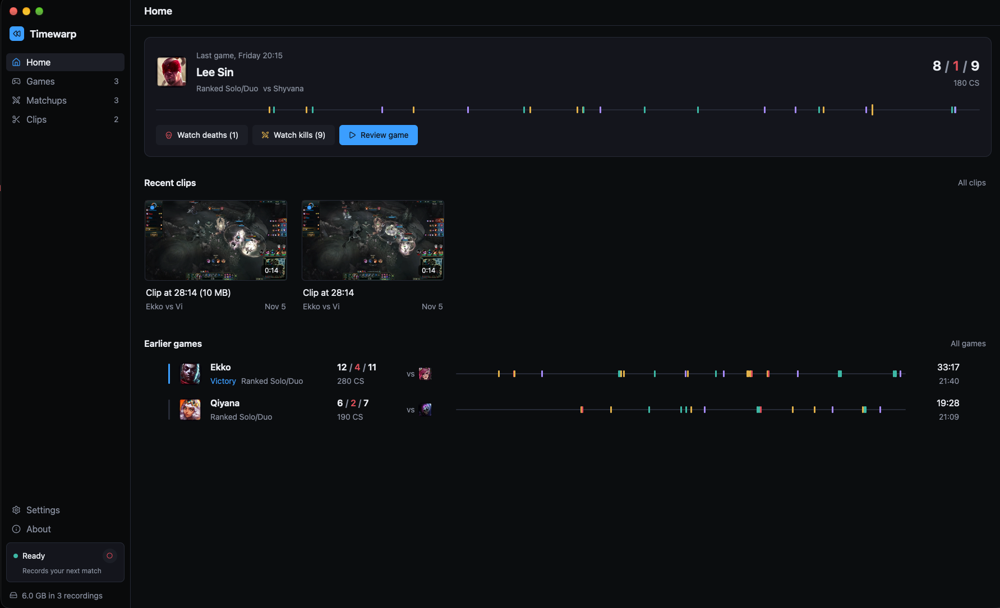
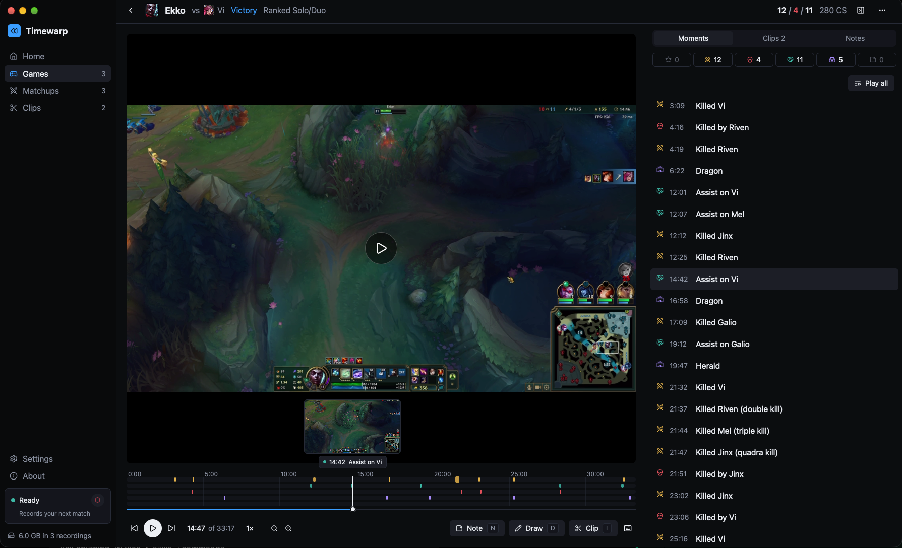
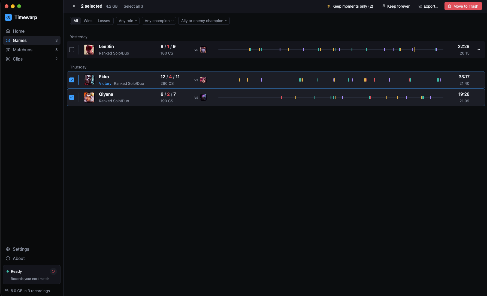
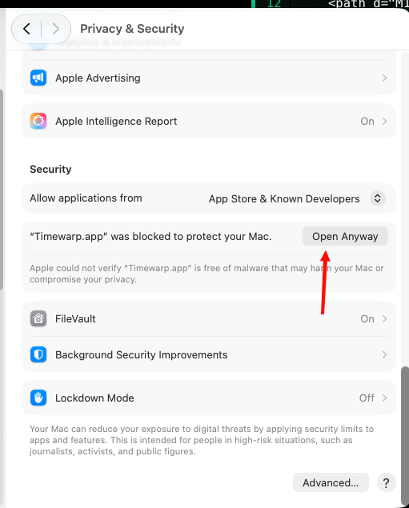

# Timewarp

Records your League of Legends games on macOS and helps you learn from them.

<p>
  <a href="docs/screenshots/home.png"></a>
  <a href="docs/screenshots/review.png"></a>
  <a href="docs/screenshots/games.png"></a>
</p>

## Install

Needs macOS 15+.

```sh
curl -fsSL https://raw.githubusercontent.com/0xInception/timewarp/main/scripts/install.sh | sh
```

Or download it from [Releases](https://github.com/0xInception/timewarp/releases). The app isn't
notarized, so macOS blocks it the first time: open System Settings → Privacy & Security and click
**Open Anyway**.

<a href="docs/screenshots/open-anyway.png"></a>

To build it yourself: `cargo run --release -p timewarp-desktop`

## Local only

No account, no cloud, no telemetry. Your recordings never leave your Mac. It
only goes online for champion portraits and, if you allow it, update checks.

## Updates

Off by default. Turn on update checks in Settings, or check once from About.
Nothing installs until you click **Update**.

## Disclaimer

Timewarp isn't endorsed by Riot Games and doesn't reflect the views or
opinions of Riot Games or anyone officially involved in producing or managing
Riot Games properties. Riot Games, and all associated properties are
trademarks or registered trademarks of Riot Games, Inc.
